<picture>
  <source media="(prefers-color-scheme: dark)" srcset="assets/hero-dark.svg">
  
</picture>

  
  
  

I'm a research intern at **Carnegie Mellon University's [InfiniAI Lab](https://www.infini-ai-lab.cmu.edu/)** with Prof. Beidi Chen, and at **Rice University** with Prof. Yuke Wang. I hold an M.S. in Computer Science from Rice.

Model capability keeps scaling, and so does the cost of running it. I work on closing the gap between what a model *should* cost and what it actually costs in production, at three levels:
- **the model:** architectures that are efficient by design;
- **the system:** turning those savings into wall-clock speed on real GPUs;
- **the engineer:** whether coding agents can build and optimize that stack themselves. An agent runs on the same systems it improves, so every gain makes the next agent better.

 

<picture>
  <source media="(prefers-color-scheme: dark)" srcset="assets/research-dark.svg">
  
</picture>

### Selected publications

 **Vortex: Efficient and Programmable Sparse Attention Serving for AI Agents** 
Zhuoming Chen, **zxr-creator**, Qilong Feng, Ranajoy Sadhukhan, Yang Zhou, Michael Qizhe Shieh, Zhihao Jia, Beidi Chen 
[arXiv](https://arxiv.org/abs/2606.06453) · [code](https://github.com/Infini-AI-Lab/vortex_torch) · [website](https://infini-ai-lab.github.io/vortex_torch/)

 **ServerBench: How can your coding agents design specialized LLM serving systems?** 
**zxr-creator**, Zhiming Wang, Yongqi Liu, Zhaohui Wang, Shanglin Yang, Zikun Li, Zhuoming Chen, Beidi Chen 
[arXiv](https://arxiv.org/abs/2611.06841) · [code](https://github.com/Infini-AI-Lab/Server-Bench) · [blog](https://infini-ai-lab.github.io/Server-Bench/)

 **CompressionBench: How can your coding agents compress LLMs?** 
**zxr-creator**, Zhifeng Li, Zhiming Wang, Yongqi Liu, Shanglin Yang, Yang Zhou, Zikun Li, Zhuoming Chen, Beidi Chen 
[arXiv](https://arxiv.org/abs/2611.06858v1) · [code](https://github.com/Infini-AI-Lab/Compression-Bench) · [blog](https://infini-ai-lab.github.io/Compression-Bench/)

 **RISA: Recoverable Sparse Attention for Block-Diffusion Language Models** 
**zxr-creator**, Fanjiang Ye, Yuke Wang

 **An Efficient and Adaptive Watermark Detection System with Tile-based Error Correction** 
**zxr-creator**, Xinze Feng, Jingwei Zuo, Fanjiang Ye, Yi Mu, Junfeng Guo, Heng Huang, Myungjin Lee, Yuke Wang 
[arXiv](https://arxiv.org/abs/2509.02447)

<b>More papers</b> (SparSP, GenServe, R²-dLLM)

 

 **SparSP: Exploiting Communication Sparsity for Sequence-Parallel Video DiTs** 
Desen Sun, **zxr-creator**, Yuke Wang, Sihang Liu 
[arXiv](https://arxiv.org/abs/2609.32197)

 **GENSERVE: Efficient Co-Serving of Heterogeneous Diffusion Model Workloads** 
Fanjiang Ye, Zhangke Li, **zxr-creator**, Ethan Ma, Russell Chen, Kaijian Wang, Jingwei Zuo, Desen Sun, Ye Cao, Triston Cao, Myungjin Lee, Arvind Krishnamurthy, Yuke Wang 
[arXiv](https://arxiv.org/abs/2604.04335)

 **R²-dLLM: Accelerating Diffusion Large Language Models via Spatio-Temporal Redundancy Reduction** 
Zhenbang Du, Kejing Xia, **zxr-creator**, Yonggan Fu, Nicolai Oswald, Binfei Ji, Brucek Khailany, Pavlo Molchanov, Yingyan (Celine) Lin 
[arXiv](https://arxiv.org/abs/2604.18995) · [code](https://github.com/GATECH-EIC/R2-dLLM)

Full list on [Google Scholar](https://scholar.google.com/citations?user=-AMCkEIAAAAJ&hl=en).

### Open source

| Project | What it is | Role | Stars |
|---|---|---|---|
| [**Vortex**](https://github.com/Infini-AI-Lab/vortex_torch) | Programmable sparse attention on SGLang + FlashInfer, with a workspace where agents write and benchmark new attention algorithms | co-developer |  |
| [**ServerBench**](https://github.com/Infini-AI-Lab/Server-Bench) | Agents evolve a minimal server into a specialized LLM serving system, graded by session replay and a hidden verifier | lead |  |
| [**CompressionBench**](https://github.com/Infini-AI-Lab/Compression-Bench) | Agents compress Qwen and Gemma checkpoints under 8–32 GiB budgets, judged once by a hidden verifier | lead |  |
| [**LTSM-Bundle**](https://github.com/datamllab/ltsm) | Toolbox and benchmark for training LLMs on time-series forecasting | contributor |  |

### Experience & education

| | |
|---|---|
| `2026.02 – now` | **Carnegie Mellon University**, InfiniAI Lab · Research Intern with Prof. Beidi Chen |
| `2025.01 – now` | **Rice University**, Yuke's Lab · Research Intern with Prof. Yuke Wang |
| `2024.09 – 2024.12` | **Rice University**, DATA Lab · Research Intern with Prof. Xia Hu |
| `2024 – 2025` | **Rice University** · M.S. in Computer Science |
| `2020 – 2024` | **Sichuan University** · B.Eng. in Computer Science and Technology |

**Service:** Artifact Evaluation Committee, SOSP 2026 · MLSys 2026 · PPoPP 2026

off the clock: StarCraft II and Hearthstone

