<picture>
  <source media="(prefers-color-scheme: dark)" srcset="assets/hero-dark.svg">
  
</picture>

  
  
  

I work on both research and engineering: making AI more efficient and able to run at larger scale. Most of what I build is open source.

**Research interests:** efficient model architecture · ML systems · recursive self-improvement · verifiable systems

I'm open to side projects and always open to research collaboration.

<h3 align="center">Open source</h3>

  <a href="https://github.com/Infini-AI-Lab/Server-Bench"><picture><source media="(prefers-color-scheme: dark)" srcset="assets/repo-serverbench-dark.svg"></picture></a>
  <a href="https://github.com/Infini-AI-Lab/Compression-Bench"><picture><source media="(prefers-color-scheme: dark)" srcset="assets/repo-compressionbench-dark.svg"></picture></a>
  <a href="https://github.com/Infini-AI-Lab/vortex_torch"><picture><source media="(prefers-color-scheme: dark)" srcset="assets/repo-vortex-dark.svg"></picture></a>
  <a href="https://github.com/datamllab/ltsm"><picture><source media="(prefers-color-scheme: dark)" srcset="assets/repo-ltsm-dark.svg"></picture></a>

  
  
  
  

<h3 align="center">Research</h3>

<picture>
  <source media="(prefers-color-scheme: dark)" srcset="assets/research-dark.svg">
  
</picture>

Papers and preprints are on <a href="https://scholar.google.com/citations?user=-AMCkEIAAAAJ&hl=en">Google Scholar</a>.

off the clock: StarCraft II and Hearthstone

